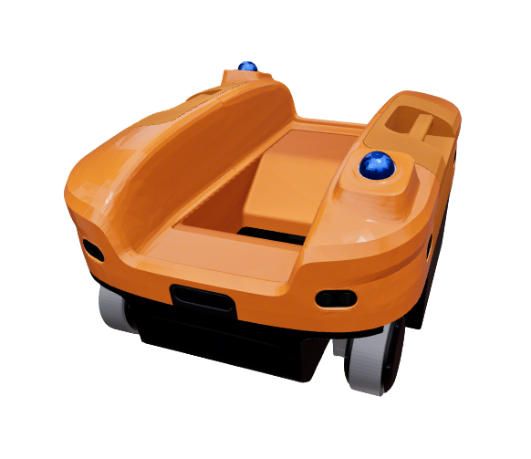
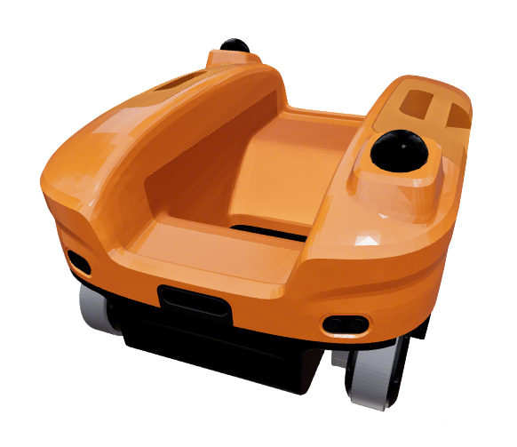
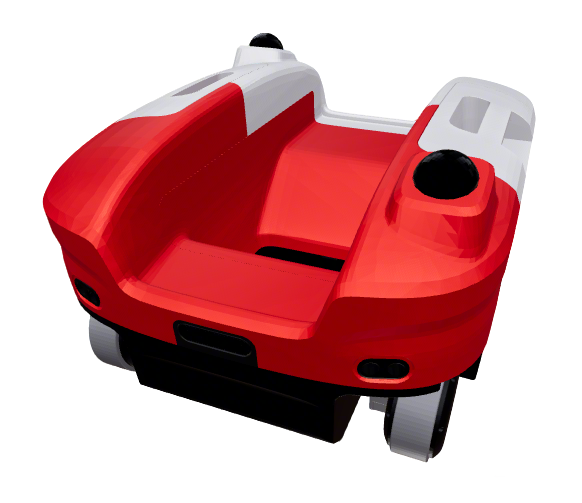
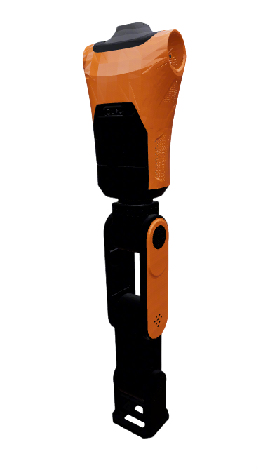
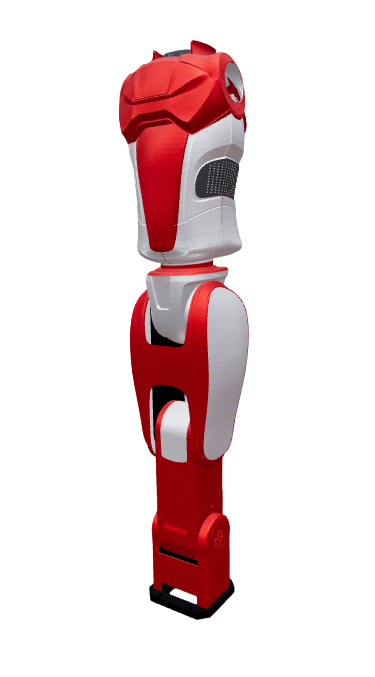
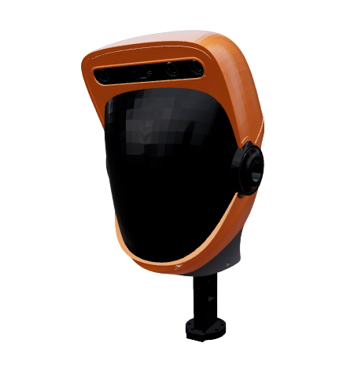
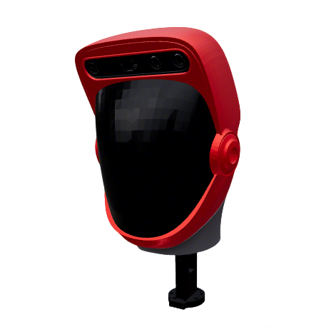

# FiveAges W2 Components

This package (`fiveages_w2_common_description`) contains reusable component descriptions for FiveAges W2:

- **Linkhou S2** chassis (`xacro/linkhou_s2.xacro`)
- **Body** torso (`xacro/components/body.xacro`)
- **Head** neck and cameras (`xacro/components/head.xacro`)

The full robot and arms component xacro remain in `fiveages_w2_description` (M6 arms) and `fiveages_w2r_description` (AR5 arms).

## 1. Build

```bash
cd ~/ros2_ws
colcon build --packages-up-to fiveages_w2_common_description --symlink-install
```

## 2. Visualize Components

Component launch uses `fiveages_w2_description/xacro/component.xacro`, which includes chassis and body from this package.

* Linkhou S2 Base V2 (default)
  ```bash
  source ~/ros2_ws/install/setup.bash
  ros2 launch robot_common_launch component.launch.py robot:=fiveages_w2_common
  ```
  

* Linkhou S2 Base
  ```bash
  source ~/ros2_ws/install/setup.bash
  ros2 launch robot_common_launch component.launch.py robot:=fiveages_w2_common type:=linkhou_s2
  ```
  

* Linkhou S2 Base (Sinopec)
  ```bash
  source ~/ros2_ws/install/setup.bash
  ros2 launch robot_common_launch component.launch.py robot:=fiveages_w2_common type:=linkhou_s2_sinopec
  ```
  
* Body
  ```bash
  source ~/ros2_ws/install/setup.bash
  ros2 launch robot_common_launch component.launch.py robot:=fiveages_w2_common  type:=body
  ```
  
* Body (Sinopec)
  ```bash
  source ~/ros2_ws/install/setup.bash
  ros2 launch robot_common_launch component.launch.py robot:=fiveages_w2_common type:=body_sinopec
  ```
  
* Head
  ```bash
  source ~/ros2_ws/install/setup.bash
  ros2 launch robot_common_launch component.launch.py robot:=fiveages_w2_common type:=head
  ```
  
* Head (Sinopec)
  ```bash
  source ~/ros2_ws/install/setup.bash
  ros2 launch robot_common_launch component.launch.py robot:=fiveages_w2_common type:=head_sinopec
  ```
  

Optional: disable movable chassis joints for static visualization:

```bash
ros2 launch robot_common_launch component.launch.py robot:=fiveages_w2 chassis_joints_movable:=false
```
